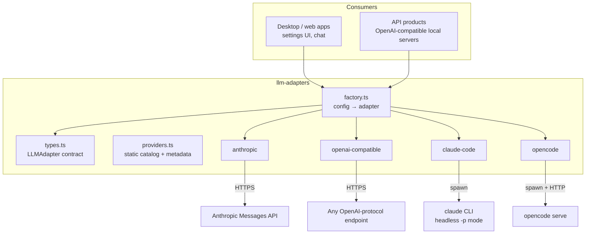

# llm-adapters — System Design

> Status: living document. Nothing here is marked **(designed)** any more —
> model discovery (§4) was the last such section and is implemented. The
> decisions that bind code which does not exist yet, including the deferred
> Python and Go ports, live in
> [docs/adr/0001-published-contract.md](./docs/adr/0001-published-contract.md).

## 1. Purpose

Applications keep needing the same thing: send a prompt, stream the answer,
not care whether the tokens come from a metered API or from a CLI the
developer already pays for through a subscription. `llm-adapters` is that
seam — one interface, two provider families (API-key and CLI-spawn), zero
leakage of either family's mechanics into application code.

## 2. Guiding principle: mechanism, not policy

The library knows **how** to talk to each provider. It never decides **when**
or **how much**:

| Belongs here (mechanism) | Belongs to the consumer (policy) |
|---|---|
| Spawning a CLI, minimal env, binary resolution | HTTP serving, routing |
| Parsing a provider's stream into `LLMStreamChunk` | Wire formats for other protocols (e.g. OpenAI SSE framing) |
| Killing the subprocess / aborting the fetch on `signal` | Deciding request timeouts, retries |
| Asking a provider which models it offers | Caching that answer, aggregating across providers |

The test for any new feature: if two consumers could reasonably want it to
behave differently, it is policy — keep it out.

Nor may the code assume a particular host application: an import from one, a
path inside one or a name that belongs to one is a bug against this design.

## 3. Architecture



### Layers

- **`types.ts`** — the contract: `LLMAdapter` (`stream`, `complete`,
  `supportsFileTools`, and the optional `listModels`), `LLMMessage`,
  `LLMStreamChunk`, `StreamOptions`, `LLMUsage`, `LLMConfig`, and
  `ProviderConfig` — the last one lives here with the other types even though
  the metadata it describes is `providers.ts`'s business. Provider-specific concerns are opt-in fields of
  `StreamOptions`; adapters ignore what they don't use. This is what lets one
  interface cover subprocess providers (which need `cwd`, `allowedTools`,
  `textOnly`, `maxTurns`) and HTTP providers (which need none of that)
  without either contaminating the other.
- **`adapters/`** — one module per provider. Each module owns *all* knowledge
  about its provider: wire/stdio format, binary resolution and PATH quirks
  (GUI apps on macOS don't inherit the shell PATH — hence the candidate list
  plus `claudeCodePath`/`opencodePath` overrides), minimal spawn env (never
  spread the host's full environment into a subprocess), stream parsing.
- **`factory.ts`** — `LLMConfig` in, adapter instance out. The only place
  that maps provider ids to constructors.
- **`providers.ts`** — static metadata: labels, descriptions, model catalog,
  defaults. The catalog is a *fallback the caller reaches for*, not the truth,
  and never something an adapter serves back as discovery — see §4.
- **`index.ts`** — the single published entry point. Deep paths into the package
  are not API, which is what leaves this layout free to change.

### Trust boundary

CLI-spawn adapters execute a local binary with the caller's OS privileges.
The adapters mitigate what they can — minimal env, no `shell: true`, explicit
binary paths — but the consumer decides *which* binary path is trusted
(`claudeCodePath`/`opencodePath` overrides are user-supplied config).
`signal` must be wired end-to-end by consumers so a disconnected client
cannot leave orphan processes.

The package installs no signal handler: shutdown is the host's policy. CLI
children are process-group leaders, so Ctrl-C does not reach them; a host that
traps SIGINT/SIGTERM calls `shutdown()`, which stops every process the package
started (including the shared `opencode serve`) and escalates to SIGKILL after a
grace period. The short-lived `execFile`/`execFileSync` probes are not
registered; they are bounded by their own timeouts.

## 4. Model discovery

### The problem

Each provider answers "which models can I serve?" differently, and the answer
may depend on what the *user* has authenticated (opencode can reach dozens of
backends, or none). A static catalog goes stale; worse, consumers start
implementing discovery *around* the library — one host app grew an HTTP route
that spawned `opencode models` itself, which is provider anatomy leaking into
application code. Discovery is provider knowledge; it belongs in the adapter,
and that route's logic is now `OpenCodeAdapter.listModels()`.

### The contract addition

```ts
interface LLMAdapter {
  // ...existing members...

  /** Ask the provider which models it can currently serve.
   *  Optional: adapters whose provider has no discovery surface omit it, so a
   *  caller feature-detects instead of catching. An adapter that CAN ask but
   *  gets no answer resolves to `[]` rather than rejecting. */
  listModels?(): Promise<string[]>;
}
```

### Per-adapter behavior

| Adapter | Implementation | Notes |
|---|---|---|
| `opencode` | Spawn `opencode models`, parse `provider/model` lines | Reflects the user's authenticated providers; 15 s timeout, augmented `PATH`, `[]` when the binary is absent or unauthenticated |
| `anthropic` | `GET /v1/models` with the configured key | `[]` on any non-ok status or network failure |
| `openai-compatible` | `GET {baseUrl}/models` | Works for OpenAI, OpenRouter, and any conformant gateway; `[]` for a gateway that only implements `/chat/completions` |
| **`claude-code`** | **Method absent** | The `claude` CLI has no listing command. It does **not** echo `providers.ts` back as discovery: a caller could not distinguish that from a live answer, so the fallback stays the caller's own knowing choice |

### Consumer rules

1. `listModels` **missing** ⇒ fall back to `ProviderConfig.models` from
   `providers.ts`. That is the only case a caller has to handle, because an
   adapter that implements the method answers `[]` rather than throwing when it
   has nothing to say. Discovery being unavailable must never make a provider
   disappear from a picker.
   Whatever comes back is a suggestion list and never a limit — model fields
   stay free text, because which models a CLI reaches depends on what the person
   running it authenticated.
2. **Caching is the consumer's job.** A UI dropdown and a public `/v1/models`
   endpoint want very different freshness; the library returns live answers
   and nothing else. (Consumers should expect a CLI spawn per call on
   `opencode` — cache accordingly.)

## 5. Consumers

| Consumer | What it layers on top |
|---|---|
| Desktop/web app settings | Provider picker, model dropdown fed by `listModels()` with static fallback |
| OpenAI-compatible local API server | Route layer, OpenAI wire translation, model registry (aggregation + TTL cache over `listModels()`), config file |
| Chat UIs | SSE bridging of `LLMStreamChunk` to their own client protocol |
